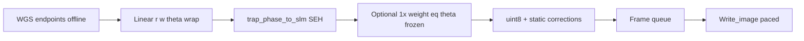

# Adapt I-SEH (Hoare et al.) to SLM-Controller

**Overview:** Adapt Hoare et al. I-SEH (interpolated superposition of elementary holograms) to this codebase by reusing the existing OpenCL SEH forward path, adding endpoint WGS + phase-continuous frame interpolation, and paced multi-frame SLM playback sized for a modest GPU rather than an RTX 5090.

**Paper:** Hoare et al., [arXiv:2610.21609](https://arxiv.org/abs/2610.21609) — same class of Meadowlark 1024² SLM. They compute each frame analytically as Φ = arg(Σ wₙ exp(i(kₙ·r′ + θₙ))), linearly interpolate positions/weights/phases between WGS-optimized endpoints, and optionally run **one** weight-equalization pass in spare GPU time. Their 0.284 ms/frame was on an RTX 5090; we will target correct sequences first, then hardware-limited playback if timing allows.

**Scope:** I-SEH sequence generation + paced SLM playback from user-defined start/end trap configs. Closed-loop occupancy → Hungarian assignment is out of scope (noted as a later phase).

## Checklist

- [ ] Fix `_traps_ready` / WGS so θ and w persist across `computeHologram` calls
- [ ] Add `iseh.py`: wrap Δθ, interpolate r/w/θ/z, SEH frames, optional 1× weight eq
- [ ] Reuse OpenCL buffers/kernel and cache `pupil_norms` for multi-frame SEH
- [ ] Preview-bypass upload + paced multi-frame `Write_image` (precompute default)
- [ ] Minimal Arbitrary Arrays UI: start/end, δ, equalize 0/1, precompute+play
- [ ] Bench SEH/eq ms vs N; verify phase continuity and uniformity metrics

## What you already have

Your forward hologram path **is** SEH (including axial Fresnel via `k_z`):

```117:129:gpu_module_v7_3.py
     for (int n = 0 ; n < n_trap ; n++) {
             float grating = k_x[n] * i + k_y[n] * j + k_z[n]* ( (i-X_max/2) * (i-X_max/2) + (j-Y_max/2) * (j-Y_max/2) );
             ...
             float2 contrib = (float2)(w * cos(ph), w * sin(ph));
             slm_phase[k] = slm_phase[k] + contrib;
```

Called from `computeHologram()` in [`gui/panels/arbitrary_arrays.py`](../gui/panels/arbitrary_arrays.py). Endpoints can use existing `WGS()`. Trap state is already `(pos, k, θ, w, pupil)` with the same `k ∝ (M/f) r` conversion as the paper ([`gui/constants.py`](../gui/constants.py)).



## Gaps vs the paper

| Paper need | Current code |
|---|---|
| Carry θ, w across frames | WGS works, but `_traps_ready()` reads panel attrs instead of `gui.*` and **reloads + randomizes θ every `computeHologram`** — must fix first |
| Interpolate r, w, θ with shortest-arc Δθ | No trajectory / sequence code |
| 1 weight update with θ frozen | WGS updates both θ and w; `slm_to_trap_amp` is **CPU NumPy** (slow) |
| Stream many frames without preview/FFT | `updatePhase()` always runs FT preview |
| Pace uploads to LC refresh | Only blocking single-frame `Write_image` |

## Modest-GPU strategy (not RTX 5090)

Do **not** assume sub-refresh real-time generation. Two modes:

1. **Precompute** (default): generate all K frames into a list/`uint8` stack, then play at a fixed interval (e.g. 1–2 ms; measure your SLM; paper uses ~0.70 ms on UHSPDM1K). Safe on Intel Arc / laptop GPUs.
2. **Live** (optional later): generate ahead of display with a small queue; if `t_compute + t_eq > t_refresh`, drop equalization or fall back to precompute.

Cost is O(M×N) per frame (M = 1024²). For N ≲ 100–300, one SEH call on a mid-range GPU is usually fine for precompute; equalization is the bottleneck unless intensity is evaluated **only at trap sites**.

Practical defaults from the paper, adapted down: step δ ≈ 0.5 μm (≲ w₀), K = ceil(max_path / δ), α ≈ 0.35, **0 or 1** equalization iters (2+ only if precomputing).

## Implementation plan

### 0. Prerequisite fix

In [`gui/panels/arbitrary_arrays.py`](../gui/panels/arbitrary_arrays.py): fix `_traps_ready` / `_ensure_traps_loaded` so WGS does not reload ROIs or re-randomize θ/w every iteration. Without this, endpoints are wrong and I-SEH continuity is meaningless.

### 1. Core I-SEH module (new)

Add something like [`iseh.py`](../iseh.py) (pure NumPy + calls into `gpu_module_v7_3`):

- `wrap_delta_theta(theta0, thetaK)` → Δθ ∈ (−π, π]
- `interpolate_frame(pos0, posK, w0, wK, theta0, thetaK, s)` → pos, w, θ (and z → k_z)
- `pos_to_k(pos)` using existing `position_to_step_per_pixel` / `_for_z`
- `seh_frame(k, theta, weight, pupil, shape)` → wraps `trap_phase_to_slm`
- `equalize_weights_once(phi, k, w, alpha=0.35)` → Iₙ from `slm_to_trap_amp` (or new sparse GPU kernel later), `w ← w (⟨I⟩/I)^α`, **θ unchanged**
- `generate_sequence(start, end, delta_um, equalize_iters=0|1)` → list of φ or uint8

Endpoint optimization: call existing `WGS` twice (or once each on start/end trap sets) to get (θ⁰, w⁰) and (θᴷ, wᴷ); intermediates never re-optimize θ.

### 2. GPU hygiene (enough for modest hardware)

In [`gpu_module_v7_3.py`](../gpu_module_v7_3.py), for streaming/precompute loops:

- Cache `cl.Kernel` once; reuse buffers; only re-upload (k, θ, w) when they change
- Cache `pupil_norms` when pupil is static
- Optionally return complex field or uint8 without reallocating every call

Defer full GPU `slm_to_trap_amp` rewrite unless precompute+equalize is too slow; for N≲256, CPU intensity at traps may be acceptable for **offline** sequences. For live mode, add a small OpenCL kernel that evaluates Σ_pixels U_SLM exp(−i kₙ·r′) per trap (N work-items), not a full image reduction.

### 3. Display path for sequences

- Add `updatePhase(preview=False)` / `upload_phase_pattern(phi)` that skips FT preview and GUI pumps during playback
- Pre-bake static corrections (manufacturer WFC + Zernike + global grating) into one additive map applied once per frame (or once into uint8 conversion)
- Worker thread: push frames → [`Meadowlark_SLM/communication.py`](../Meadowlark_SLM/communication.py) `upload_image_to_slm` paced with `QTimer`/`time.sleep` to measured interval; keep GUI responsive

Do not bind OverDrive sequence APIs until single-frame paced writes are proven.

### 4. GUI (minimal)

In Arbitrary Arrays (or a thin “Rearrange” strip):

- Load / set **start** and **end** trap coordinates (reuse existing JSON / npy loaders)
- Controls: δ (μm), equalize iters (0/1), α, play / precompute+play, cancel
- Status: N frames, mean compute ms/frame, estimated duration
- Register method or button: “I-SEH sequence” (WGS endpoints → generate → play)

### 5. Validation without fancy GPU

1. Stationary: I-SEH with K=1 matches one SEH/WGS frame
2. Continuity: plot per-trap Δθ between consecutive frames (should be ≈ Δθₙ/K)
3. Uniformity: RMS of Iₙ with 0 vs 1 equalization (expect large improvement, paper: ~20% → ~1%)
4. Timing: log SEH ms and equalize ms vs N; decide precompute vs live
5. Hardware: empty-trap / camera intensity movie if available; else SLM upload + survival later

### 6. Later (not in first implementation)

- Occupancy from camera → JV assignment minimizing Σd²
- Extinguish unused traps (drop w=0 from the sum)
- Axial leapfrog paths (your `k_z` already supports z interpolation)
- Blink sequence/preload APIs if single-frame pacing saturates

## Key files to touch

- [`gpu_module_v7_3.py`](../gpu_module_v7_3.py) — buffer/kernel reuse; optional sparse intensity kernel
- [`gui/panels/arbitrary_arrays.py`](../gui/panels/arbitrary_arrays.py) — trap-ready fix; WGS endpoints; I-SEH button / params
- New [`iseh.py`](../iseh.py) — interpolate + sequence generation
- [`gui/main_window.py`](../gui/main_window.py) — `updatePhase` preview bypass
- [`Meadowlark_SLM/communication.py`](../Meadowlark_SLM/communication.py) — only if non-blocking/paced write helpers are needed

## Success criteria

- Defect-free start→end trap motion holograms with continuous θ, generated on your current GPU via precompute
- Optional 1-iter weight equalization that improves uniformity without requiring RTX-class hardware
- Playback that does not freeze the GUI or run a full FT preview every frame
- Documented ms/frame vs N so you know when live generation becomes viable on a faster machine
